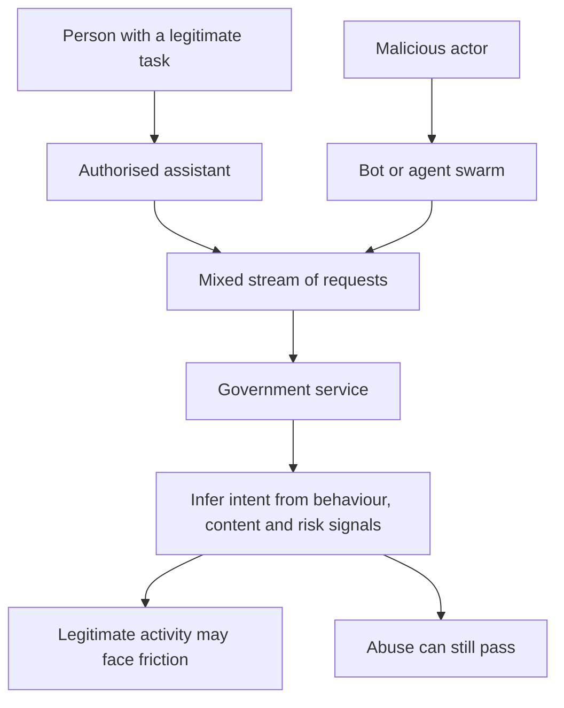
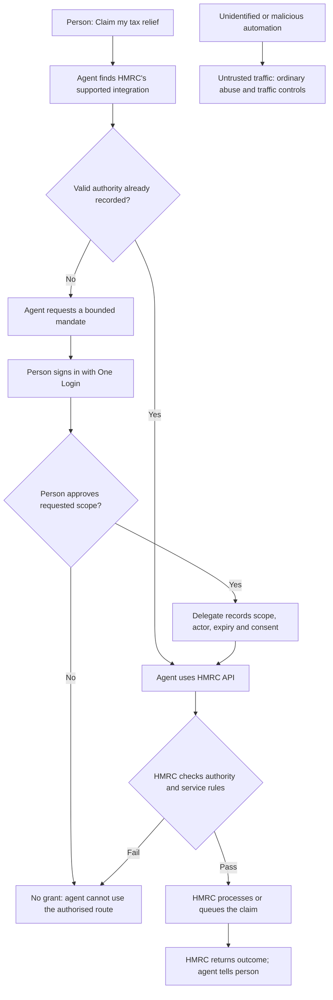
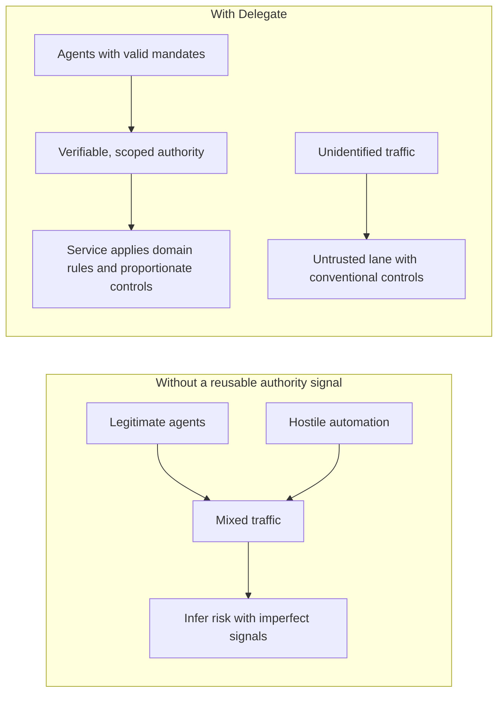

# How Delegate changes the agentic flooding problem

> **Status:** Product hypothesis and explanatory diagrams, not evidence of measured flood reduction. This is an independent synthetic prototype, not an official government service.

## The problem: mixed traffic

A service cannot infer authority merely from an agent's appearance, generated text, request rate or claim of being helpful. Nor is every large increase in legitimate claims an attack.

## The proposed route: independently verifiable authority

**The agent should discover and choose the authorised route without being told to use Delegate by name.** This is a behaviour to test, not something the existence of an API guarantees. Delegate establishes who may act and within what limits; the agent plans the task; HMRC owns the transaction, idempotency, queueing, eligibility and rate limits.

## Before and after

This **shrinks the ambiguous middle**, rather than stopping the flood. Verified authority is not proof of good intent: fraud, compromised credentials and coercion remain possible. Unidentified traffic is not proof of wrongdoing: legitimate assistive technology and people who cannot use the digital authorisation route must not be excluded.

## What would demonstrate value?

Compare the **same good agent API with service-local delegation** against **that API plus Delegate**. Measure independently authorised activity, route choice without prompting, legitimate completion and user friction, refusal/abuse outcomes, technical load and cost. Do not credit Delegate for effects of queueing, idempotency or API quality. See [validation](VALIDATION.md), [evidence](EVIDENCE.md), [current behaviour](CURRENT_BEHAVIOUR.md) and [architecture](ARCHITECTURE.md).
