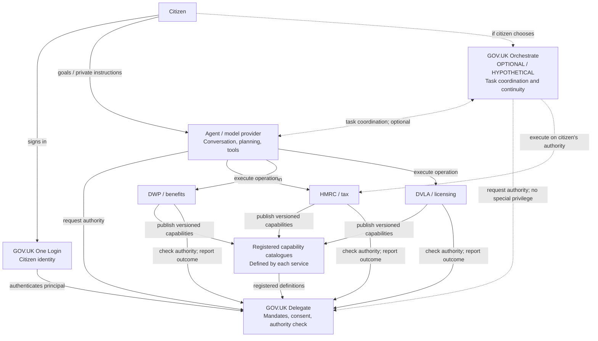

# GOV.UK Delegate and the possible GOV.UK Orchestrate

> **Status:** Target architecture and product boundary, agreed for this independent prototype. Orchestrate is a *hypothetical complementary service*, not a component we have committed to build. Distinguish **current prototype** from **target** and **hypothetical** below.
>
> **One sentence:** **Delegate governs who may act for a person; Orchestrate (or a private AI provider) works out what to do and coordinates doing it; government services determine whether a transaction is valid and carry it out.**

## 1. Why draw this boundary?

An AI assistant can reduce the effort of dealing with government, but signing in as a citizen or merely declaring itself an AI does not establish authority to act. Conversely, an authority platform should not need to understand a citizen's private goals or run their task workflow to verify delegated permission.

We want a cross-government arrangement in which:

1. A citizen chooses a representative: a person, organisation or software agent.
2. The citizen grants *bounded, independently recorded authority* to use particular services.
3. The representative can plan and complete tasks through the relevant service interfaces.
4. Each service validates the authority **and** its own eligibility, policy, consent and transaction rules.
5. The citizen can inspect the grant and relevant outcomes, restrict it, revoke it, or challenge a transaction.
6. Useful automation is easier to identify, authorise and integrate than pretending to be a human.

**Not all task instructions are authority.** "Get my tax sorted" describes a goal. "May submit a working-from-home claim for tax year 2026–27, but may not change my bank account" specifies enforceable boundaries. The former belongs with the chosen assistant; the latter is the kind of fact Delegate can record and services can enforce.

## 2. Products and responsibility boundaries

| Component | Primary question | Owns | Explicitly does **not** own |
|---|---|---|---|
| **GOV.UK One Login** | Who is this person? | Citizen authentication and identity evidence | What representatives can do |
| **GOV.UK Delegate** | Who may act for whom, where, within which limits, and until when? | Representative registration/identity evidence, service capability catalogue, consent/mandate record, narrowing/sub-delegation, check/revocation, approval evidence and authority audit | Tax/benefit eligibility, transaction execution, private task plans, agent reasoning, blanket fraud decisions |
| **Government service** (HMRC, DWP, DVLA, council) | Is this operation valid, authorised and executable? | Definitions and human-readable meaning of its delegable capabilities; service-specific constraints/assurance requirements; domain rules; transactional confirmation; idempotency; processing and outcomes | Agent planning or cross-government authority unrelated to its resources |
| **Model provider / personal agent** | What does the person want done and how? | Conversation, goals, plans, tools, documents, execution, follow-up, within granted boundaries | Creating its own government authority or overruling service decisions |
| **GOV.UK Orchestrate (hypothetical)** | How can a citizen's multi-step, cross-government task be carried through? | Potential user-facing task workspace, coordination across services and agents, durable task progress, handoffs, accessibility/assisted channels, provider portability | Acting without Delegate-granted authority; making substantive departmental decisions; replacing every AI provider |
| **Security/abuse services** | Is use harmful, anomalous or fraudulent? | Security controls, monitoring, investigation, risk treatment under appropriate law and policy | Automatically equating unidentified automation with fraud |

An Orchestrate product, if it existed, would be a **consumer of Delegate**, not a privileged bypass. It may itself be appointed as a representative, or may coordinate separately authorised representatives; either way, the citizen must control every required grant.

## 3. Reference architecture



**Important:** this diagram is a *target pattern*, not a claim that the prototype integrates with DWP, DVLA or a real Orchestrate service. The current demo has synthetic One Login, Delegate and mock HMRC. Arrows to Orchestrate are deliberately dotted.

For a portable, readable view of the architecture, see the About site's **Delegate or Orchestrate?** page. This document is the canonical source for engineering decisions.

## 4. How service-defined capabilities work

**Target:** departments publish their own versioned catalogue through a trusted service registration process. Delegate validates, stores and renders a generic representation; it does not author tax-specific permissions or invent permissions on the fly from agent prose.

The publication/discovery foundation is implemented: a registered service publishes bounded, immutable versions with its own credential. See [the implemented protocol](SERVICE_CATALOGUES.md) for the actual schema and endpoints. HMRC catalogue-backed bootstrap is under review in [PR #86](https://github.com/sighmoan1/govuk-delegate-starter/pull/86); generic consent and consent snapshots remain follow-up work (#30–31).

The following is a target-model illustration, **not valid input to the implemented publication API**:

```json
{
  "service": "hmrc-personal-tax",
  "catalogue_version": "2026-10",
  "capabilities": [
    {
      "id": "view_claim_status",
      "label": "Check your claims",
      "risk": "low"
    },
    {
      "id": "manage_job_expenses_claim",
      "label": "Manage a job expenses claim",
      "risk": "medium",
      "allowed_constraints": {
        "tax_year": { "type": "string" },
        "claim_reference": { "type": "string" }
      }
    }
  ]
}
```

Design rules:
- Capability identifiers are **service-scoped**, stable and versioned; another service's `view_status` is not interchangeable.
- The **service** owns the labels, operation meaning, policy metadata and schema for supported constraints, with appropriate governance of what it may publish. Delegate can apply cross-government minimum security/assurance requirements.
- The **citizen** can grant a subset and narrow its limits. A delegate or sub-agent can never widen them.
- The **service** enforces service-specific transaction constraints against trusted grant data; Delegate enforces generic mandate/identity/expiry/chain conditions.
- Do not let a catalogue update silently broaden an active grant. Store a consent snapshot, version, and a migration/re-consent policy for breaking changes.
- Do not display untrusted HTML from a service catalogue. Registered service identity, update credentials, schemas and content must be validated.
- The agent may request capabilities; it cannot register or redefine the department's capabilities.

This builds on the *idea* behind OAuth 2.0 Rich Authorization Requests (RFC 9396): structured, resource-specific authorisation details. It is not a claim that the existing prototype implements that RFC, nor a commitment to one credential format.

## 5. Mandates: consent without a central task manager

A **mandate** is an independently recorded grant from the principal to a particular representative, scoped to a service (or to an explicit group of service-specific grants), with dates, structured permissions, enforceable constraints and evidence of what the person approved.

Illustrative mandate (target, not implemented):

```json
{
  "principal": "person-reference",
  "representative": "assistant-reference",
  "purpose_label": "Manage my working-from-home claim",
  "grants": [
    {
      "service": "hmrc-personal-tax",
      "catalogue_version": "2026-10",
      "capability": "manage_job_expenses_claim",
      "constraints": { "tax_year": "2026-27" }
    }
  ],
  "valid_until": "2026-11-08T23:59:00Z"
}
```

The `purpose_label` helps a person recognise why they granted access. It **does not** grant more rights than the structured `grants` array. Free-text task prompts (including "do everything possible") are not authority controls.

For each grant, retain a tamper-evident or immutable consent-evidence snapshot: representative shown, registered service, capability definitions and versions, specific restrictions, consent action, time and assurance. That evidence supports review and dispute; it is not proof that every later statement was correct or voluntarily instructed.

**Standing discretion:** a citizen may authorise routine actions without reviewing each individual transaction, where the receiving service's rules permit that. Fresh approval is required where a service-specific rule, risk threshold or legal requirement demands it. Self-asserted agent confirmation is not independent proof of citizen agreement. A high-risk approval should be bound to the **specified transaction**, not merely to a broad capability check.

**Portability:** a citizen may reuse a mandate *template* when switching assistants, but the replacement assistant receives no authority until the citizen makes a new explicit grant. A template is not a transferable bearer credential.

## 6. Cross-service tasks without cross-service superpowers

Citizen: **"Help me move house."**

The chosen assistant or hypothetical Orchestrate may identify three tasks:
- DVLA: update driving licence address;
- HMRC: update tax records address;
- local council: update council tax address.

Delegate may present **one coherent consent journey**, but creates **separate service-scoped grants**. Each service approves its own action definition; no department can use the existence of the overall task to infer authority it was not given. Granting HMRC permissions cannot implicitly grant DVLA permissions.

This supports cross-government coordination without a central government store of complete prompts, personal planning data and model reasoning.

## 7. What Orchestrate might add (and why it may never need to exist)

**Orchestrate is currently theoretical.** Today model providers and users' chosen assistants already provide many orchestration functions: interpreting a goal, decomposing tasks, choosing tools, searching, acting, following up and reporting results.

A public-service-specific Orchestrate could nevertheless add functions that commercial providers may not consistently supply:

| Candidate capability | What it adds beyond a private assistant |
|---|---|
| **Durable civic task record** | Citizen-controlled continuity across agent providers and service outages |
| **Provider-neutral handoff** | Switch agents without exposing passwords or losing service references and progress |
| **Multi-service coordination** | Track separately authorised steps and dependencies without giving a universal grant |
| **Human and assisted-digital handoff** | Continue the same work with a call centre, adviser, family member or another representative |
| **Status aggregation** | Surface receipts, next actions and service outcomes from participating departments |
| **Fairness and accessibility** | Explain steps, deadlines, escalation and redress independent of provider UI |
| **Citizen-selected providers** | Enable competition and avoid one provider owning the whole task history |

These are **hypotheses for a separate product case**, not commitments, and each requires privacy, legal, commercial, safety and user-research scrutiny. A government Orchestrate may be unnecessary if open standards, exportable task records and existing providers offer the same benefits. It should not become an obligatory gateway or the only way to use government services.

The distinction is not **government AI versus commercial AI**. It is **authority infrastructure versus task execution/orchestration**. Orchestrate could be government-run, third-party or absent altogether; Delegate should work in all three cases.

## 8. How a request should work

1. The citizen tells their chosen assistant what outcome they want (kept with that provider unless the citizen opts otherwise).
2. The assistant discovers a department's API and *service-defined* delegable capabilities.
3. The assistant requests only the authority it needs. A registered service may initiate the request for browser agents.
4. The citizen authenticates independently with One Login and approves a clearly described, service-scoped mandate and its constraints in Delegate.
5. The assistant performs a transaction through HMRC's API. HMRC checks current authority with Delegate and enforces its own business, assurance, confirmation, duplicate and technical-throughput rules.
6. HMRC records a durable transaction result and reports relevant attributable outcomes/receipts to Delegate; a check ALLOW is **not** proof of successful completion.
7. The citizen can narrow/revoke authority and challenge events; services determine the appropriate legal and operational consequences for actions already accepted.

No actor may approve its own grant. Unknown or unverified automation is not automatically malicious; it may need a legitimate route to identify itself.

## 8a. Open question: should every authority record be owned by Delegate?

**Not decided.** A shared citizen experience does not require a central source of truth for every legal or administrative representative relationship. Some authority can be issued through Delegate; other authority (department-managed agent relationships, appointed representatives and powers of attorney) may need to remain with its originating authority.

The central registry, fully federated and hybrid alternatives—including privacy, provenance, revocation and outage consequences—are evaluated in [Where authority lives: central, federated or hybrid?](FEDERATED_AUTHORITY.md). We favour **testing** hybrid recognition, not pre-selecting it. No federation feature has been implemented.

## 9. Failure and trust boundaries

- **Delegate unavailable:** the service must not infer an ALLOW. Provide safe retry or a legally adequate alternate route; accepted service transactions must not vanish.
- **Service catalogue unavailable:** use a validated prior version for existing mandates only under a deliberate freshness policy; do not invent scopes from an agent request.
- **Grant revoked after submission:** block *new* unauthorised actions; preserve already accepted transaction history and apply the receiving service's rules to in-flight work.
- **Agent compromised or provider changes:** revoke/suspend affected identity or mandate, maintain event attribution, and require fresh approval for replacement representatives.
- **Constraint enforcement:** generic structural comparison can live in Delegate; domain-specific meanings must be checked by the receiving service. Fail closed on unsupported constraints.
- **Cross-service identity:** the demo shares One Login subject values, while real relying parties may receive pairwise subjects. Production requires authorised mapping or an appropriate sector arrangement—not a public universal citizen identifier.
- **Privacy:** a central mandate ledger is sensitive; minimise purpose text and avoid storing prompts, model reasoning, documents and complete government case contents in Delegate. Use service-side references for outcomes.
- **Fairness:** legitimate claims remain legitimate when submitted by agents. Separate eligibility/transaction integrity from API throttling, queues and abuse signals; a quota on authorisation lookups must not become a quota on legal entitlements.

## 10. Current implementation versus target

| Capability | Current independent prototype | Target / separate idea |
|---|---|---|
| One Login + Delegate consent lifecycle | **Implemented** with simulator and synthetic identities | Real relying-party integration and identity correlation |
| Service catalogue publication/discovery | **Implemented**: authenticated publication, immutable history, bounded schema, public discovery | Governed catalogue lifecycle and service adoption |
| HMRC delegation permissions | **Implemented**, HMRC-owned catalogue bootstrap with historical grant preservation (#86) | Generic consent and immutable consent snapshots (#30–31) |
| Rich structured constraints | **Not implemented**; mostly flat capability codes | Structured grant/mandate constraints |
| User-facing task purpose | **Not a structured consent object** | Human-readable label, not an authorisation bypass |
| HMRC authority checks and revocation | **Implemented** | Generic, service-neutral check plus structured grants |
| Cross-service bundles | **Not implemented** | Optional grouped consent, never blanket implicit authority |
| Citizen-visible receipts/outcomes | **Implemented**: service outcomes, receipt retries, disputes and freshness reporting; limited recent-history views | Retention, pagination, notification and production resilience policy |
| Orchestrate service | **Not built** | **Hypothetical, not in Delegate scope** |

The prototype's earlier decision "Identify the agent. Authorise the mandate. Limit the principal" describes its original demo design. Our target clarifies that Delegate owns **authority**, while the receiving service owns **transaction integrity and throughput**. The engineering work in #17–#23 is merged: authority checks spend no citizen allowance; HMRC separates business constraints from technical throttles, handles idempotent submissions, processes durable claims through a fair queue, and supports conditional progress polling. Numerical limits remain illustrative; service policy and legal decisions are deferred (DB-04).

## 11. What to build next

Build on the merged catalogue publication foundation by completing: (1) dynamic generic consent rendering; (2) structured enforceable mandates with a stable check contract; (3) an independent second mock department as a decoupling proof; (4) optional grouped consent and grant-template portability. These are distinct implementation phases.

**Acceptance test for the architectural boundary:** a new government service can publish its own capability catalogue, offer consent, check mandates and receive an enforceable result **without adding a service-specific capability or endpoint to Delegate's application code**.

### Related documents

- [Product case](PRODUCT_CASE.md)
- [Architectural decisions](DECISIONS.md) (Decision 28)
- [Where authority lives: central, federated or hybrid?](FEDERATED_AUTHORITY.md) — **open decision**
- [Original build specification](BUILD_SPEC.md) (historical brief)
- [RFC 9396 — OAuth 2.0 Rich Authorization Requests](https://www.rfc-editor.org/rfc/rfc9396)
- [RFC 8707 — Resource Indicators for OAuth 2.0](https://www.rfc-editor.org/rfc/rfc8707)

## Observatory research boundary

`apps/observatory` is independently built and served on local port 3303. It owns database `observatory`, a separate database login and generated Prisma client. It is a research workbench with explicitly enabled, minimised read-only source feeds and append-only research collection. There are no classifiers or operational decision hooks. No HMRC or Delegate startup dependency points to it. Stopping Observatory leaves their authority, queue and service journeys running.

See [research protocol](observatory/RESEARCH_PROTOCOL.md) and [setup and verification](observatory/SETUP.md). It is not GOV.UK Orchestrate or the unimplemented historical Example AI app.
