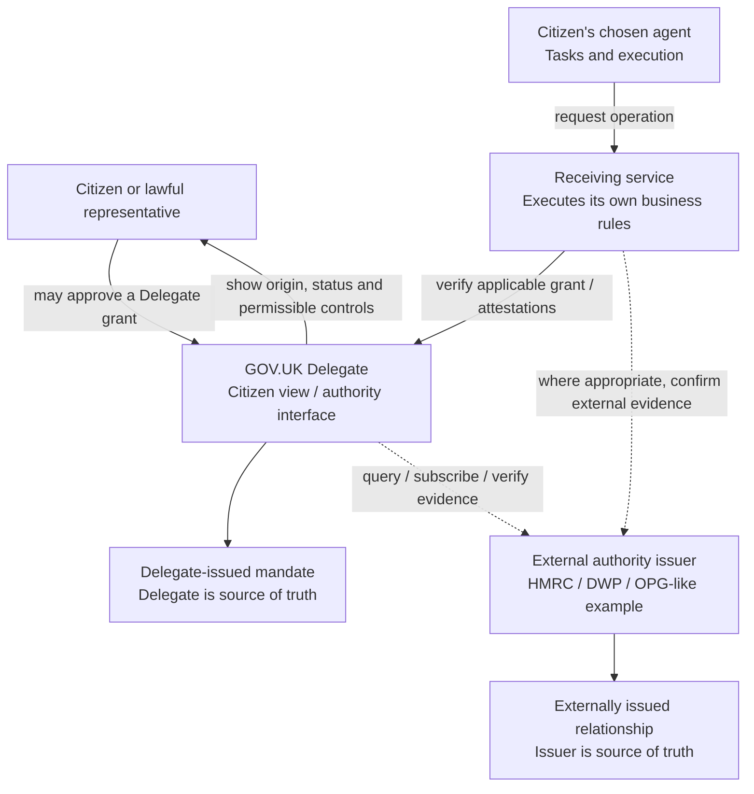

# Where authority lives: central, federated or hybrid?

> **Status: OPEN architectural decision.** This document describes alternatives and a testable hypothesis. It **does not select a production architecture**, change the currently implemented online check, or mean a federated solution has been built.
>
> **Preferred hypothesis for investigation:** Delegate directly manages grants created through its own consent process, while recognising appropriate *externally issued authority* from systems that legally or operationally own it. The common citizen experience does not imply a single database owns every form of authority.

See [ARCHITECTURE.md](ARCHITECTURE.md) for the settled **Delegate vs Orchestrate** responsibility boundary. This document addresses a **different** question: *where are delegation records authoritative, and how do other systems establish whether that authority is sufficient?* Federation is not orchestration.

## 1. The unresolved question

A citizen ought to be able to understand and manage **who can act for them** without learning the implementation details of every department. That user-facing promise does **not** logically require a comprehensive national store of all tax agents, DWP appointees, attorneys and other representatives.

Two questions must remain separate:

1. **Origin and evidence of authority:** Who granted or conferred a representative's powers, according to which legal/administrative regime, with which evidence and conditions?
2. **Recognition by a service:** Is that authority accepted for *this service, resource, action and time*? What extra identification, assurance, consent or decision-making is required?

A person pressing **Approve** in Delegate can create a mandate where such consent is a valid mechanism. But some authority is **appointed**, arises under a legal instrument, or is recorded through an existing departmental process. Delegate cannot simply manufacture that authority on the principal's behalf.

A generic grant may be necessary without being sufficient for a particular business transaction. HMRC, DWP and other receiving services still apply their own law, assurance and process rules.

## 2. Three architectural options

| Option | Authority source of truth | What Delegate does | Strengths | Risks/trade-offs |
|---|---|---|---|---|
| **A. Central registry** | Delegate owns all mandates; services check it | Holds every grant and revocation | One citizen view, coherent APIs and consent, simple immediate revocation for Delegate grants | Central sensitive relationship graph; migration/replication of existing legal authorities; departments may not be able to cede their decision rights; central operational dependency |
| **B. Fully federated** | Each originating authority/department owns its own records | Discovers, brokers and aggregates authority; perhaps routes check requests | Can respect existing legal systems and minimise central relationship storage; departmental autonomy | Heterogeneous interfaces, mismatched semantics, availability and revocation consistency, harder citizen UX, fragmented evidence and audit |
| **C. Hybrid** | Delegate owns Delegate-issued grants; recognised issuers own externally-issued authority | One citizen experience; distinguishes issuer and evidence; verifies or routes recognition appropriately | Incremental adoption; preserves existing regimes; central consent when useful without claiming to replace all authority records | Two patterns to implement, freshness and conflict rules, strong trust/identity and provenance needed |

**Tentative direction: C.** Treat it as a hypothesis, not a binding decision. A fully federated *technical deployment* is not required to support **federated origins of authority**: a service can provide signed attestations, online verification, or an accredited issuer adapter behind a common interface.

## 3. Authority is not one uniform thing

Illustrative categories (not exhaustive or claims that production integrations currently exist):

- **Citizen-created mandate:** a person authorises a chosen AI agent, adviser or family member within a service's permitted powers. Delegate could be the authoritative issuer.
- **Department-managed agent relationship:** a tax service may already have its own agent authorisation process and record. Delegate could show and verify its status *as reported by that department*.
- **Appointed representative:** some DWP appointees are recognised through an appointment process rather than a simple citizen click. Delegate must not claim an unqualified power for the person to create or revoke this relationship.
- **Legal authority:** for example, a power of attorney has its own legal effect, conditions, limitations, dates and evidence. Delegate might help present evidence but does not replace the responsible authority or decide legal effect.

This means an `authority_origin` / `issuer` matters as much as `representative` and `capability`. Treat “record exists”, “issuer attests it is valid” and “receiving service accepts it for this operation” as three distinct propositions.

## 4. Target responsibility model



**Important:** the diagram deliberately distinguishes the **citizen interface**, an **issuer**, and the **service that recognises authority**. It is illustrative. A production architecture may allow direct service-to-issuer verification rather than making Delegate a mandatory hop.

Delegate should **never**:
- Infer authority merely because a person appears on another service's records.
- Allow an agent to assert or register itself as a trusted issuer.
- Present an externally issued authority as “created by Delegate”.
- Offer “revoke” as if immediate revocation is guaranteed when it can only *request* the responsible issuer to terminate a relationship.
- Treat an external system timeout as either “valid” or “no authority exists”.
- Use a cross-government universal person identifier as an expedient join key.
- Acquire comprehensive case data, prompts or conversation histories simply to aggregate authority.

## 5. Minimum shared vocabulary and API contract

A common representation needs **provenance and status**, not just an `authorised: true` boolean.

An illustrative relationship projection (not yet implemented):

```json
{
  "authority_id": "ext-hmrc-relationship-123",
  "origin": "EXTERNAL",
  "issuer": "hmrc-personal-tax",
  "principal_ref": "service-scoped-person-reference",
  "representative_ref": "representative-reference",
  "source_reference": "opaque-issuer-reference",
  "display_label": "Tax agent",
  "permissions": [{ "capability": "manage-tax-agent-matters" }],
  "status": "ACTIVE",
  "verified_at": "2026-10-09T10:00:00Z",
  "valid_until": null,
  "management": {
    "revoke_supported": false,
    "issuer_route": "service-specific-support-reference"
  }
}
```

Fields and semantics to agree **before** production use:

- `issuer`, `authority_origin`, issuer's opaque reference, issuer identity assurance and trust configuration;
- principal identity matching **limited to the intended receiving service and purpose**;
- representative identity and the evidence/assurance appropriate to the relationship;
- structured authority scope, conditions, issuance/effective/expiry dates, optional source's legal/administrative basis;
- current status: at minimum **ACTIVE, REVOKED, EXPIRED, PENDING, UNKNOWN/UNAVAILABLE**; never map `UNKNOWN` to `ACTIVE` or “no relationship”;
- **verified_at**, evidence freshness and whether an answer is a *snapshot* or a *live issuer decision*;
- permitted management operations: view, request amendment, request revocation, actual revocation, appeal/correction contact;
- scope, redaction and audit rules for status and relationship visibility.

**Decision contract:** a central `checkAuthority` call might cover Delegate-issued grants directly, and externally issued authority via an issuer adapter or a verified attestation. The result must distinguish **authority claimed/verified** from the **receiving service's own final decision**. If the issuer must decide whether an act is legally permitted, the final decision remains with that service; Delegate should not invent an `ALLOW` on its behalf.

**Integration mechanics to evaluate:** direct authority API lookup, short-lived audience-bound signed attestations, narrowly scoped delegation tokens, an interoperable authorisation-decision API (e.g. AuthZEN patterns), or an issuer registry/federation of trusted issuers. None removes the need for business enforcement.

## 6. Revocation, outage, and disagreement

| Scenario | Safe behaviour |
|---|---|
| Delegate-issued grant revoked | Delegate denies new attempts; service applies its rules to already received work. |
| External issuer reports revocation | Update displayed status with source/time; new enforcement must respect the issuer's authoritative state. |
| Citizen asks Delegate to revoke an external appointment | Show a request to the responsible authority *only if supported*; do not claim success until acknowledged. Some authority may not be revocable by this citizen. |
| External issuer unavailable | Show **status unavailable / last checked at X** rather than “no representatives”. Do not authorise a fresh high-risk transaction from stale or unknown evidence. Provide retry/assisted route as appropriate. |
| Service and Delegate disagree | Explain which issuer controls the relationship; do not override departmental legal/policy decisions with a cached projection. |
| Delegate unavailable | A service's own authoritative records may remain usable where its policy allows; don't silently accept unauthenticated assertions. |
| Identity ambiguity | No silent merge of two citizens or two representatives. Request further proof/reconciliation. |

Revocation is only “immediate” within a defined trust and consistency model. A cache or portable proof has an explicit staleness window. The citizen-facing interface must not promise universal instantaneous changes where that cannot be delivered.

## 7. The smallest useful prototype experiment

**Keep current flows intact.** Add a **synthetic** second authority source to prove that Delegate can show and verify a record it does **not** own.

**Proposed arms (both for one synthetic person and agent):**

1. **Delegate-managed AI grant:** existing `Authorisation` + `Delegation` are stored and revoked by Delegate.
2. **Department-managed relationship:** mock HMRC owns a separate representative relationship, with its own `get-status` and controlled `revoke` or `revoke-not-supported` behaviour. Delegate fetches a *projection* or forwards an authenticated verification request. No duplicate authoritative grant is written into Delegate.

**Demonstrate:**
1. Citizen opens **Who can act for you** and sees both relationships, **issuer visibly labelled**.
2. Revoke the Delegate-managed grant: new checks fail, but the HMRC-owned relationship remains.
3. Change the HMRC-owned relationship *in HMRC*; refresh Delegate's view and observe status, issuer and verification timestamp update.
4. Deliberately stop HMRC: Delegate displays **temporarily unavailable / previously checked at...**, not an empty list. Sensitive checks fail closed or use a deliberate service-owned fallback; document which.
5. Try to revoke the externally owned relationship in Delegate: either a real issuer-supported request receives authoritative confirmation, or Delegate explains that management is done with HMRC. Never silently mark an external record revoked.
6. Confirm principal isolation, wrong-service authentication denial and no cross-service data leakage.

**Scope control:** no real departments, no OpenID trust-federation deployment, no universal identity system, no cryptographic credential issuer unless specifically needed to prove a decision, and no Orchestrate. A fake HMRC relationship stored only in Delegate would **not** count as proving federation.

## 8. What we will measure and decide

| Question | Evidence needed |
|---|---|
| Can one citizen interface combine two authorities honestly? | Distinct issuers/sources, correct labels, status and management actions. |
| Can services integrate without central business logic? | No HMRC authority-semantics hardcoding in Delegate. |
| What happens when an issuer is offline? | Correct UNKNOWN, safe authorisation result, no silent disappearance. |
| Can permission be withdrawn appropriately? | Instant Delegate revocation; explicit issuer-controlled behaviour externally. |
| Does federation actually reduce sensitive central data? | Inventory of stored identifiers, attributes, relationships and logs. |
| Can accounts be matched safely? | Synthetic service-scoped identity mapping; coordinate with [identity spike #35](https://github.com/sighmoan1/govuk-delegate-starter/issues/35). |
| Is complexity justified? | Compare integration effort, citizen comprehensibility, reliability, privacy and audit against central-only model. |

**Decision gate:** once the experiment passes, decide whether to (a) extend hybrid recognition, (b) centralise only citizen-created electronic mandates, or (c) pursue more ambitious federation. Record that decision in `DECISIONS.md` with evidence and amend `ARCHITECTURE.md` and the About site accordingly. Until then, **federation remains an option, not the committed target**.

## 9. Relation to existing work

- [#28 — service-owned capability catalogues](https://github.com/sighmoan1/govuk-delegate-starter/issues/28) concerns **who defines permission vocabulary**, not who stores grants.
- [#33 — second mock service](https://github.com/sighmoan1/govuk-delegate-starter/issues/33) proves **service independence**, not externally sourced authority.
- [#35 — pairwise One Login subject mapping](https://github.com/sighmoan1/govuk-delegate-starter/issues/35) is an identity boundary this experiment needs to respect.
- [Delegate vs Orchestrate](ARCHITECTURE.md) remains the agreed product boundary whatever authority-storage option is chosen.

**Architectural invariant:** a common interface for **understanding and controlling representatives** need not mean a central system has legal ownership or omniscient knowledge of every representative relationship.
